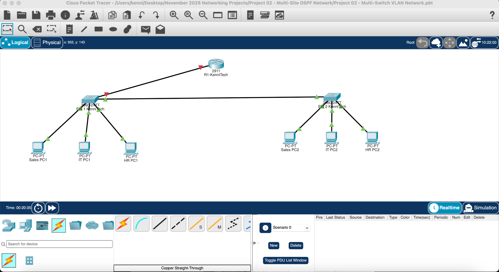

# Project 02: Multi-Switch VLAN Network

**KenniTech Networking Project Portfolio**  
**Implementation date:** 14 November 2026  
**Platform:** Cisco Packet Tracer on macOS

## Project overview

This project builds a small departmental network across two Cisco 2960-24TT switches. A Cisco 2911 router provides inter-VLAN routing using router-on-a-stick. The router also provides DHCP for the Sales, IT and HR networks.

The design uses three VLANs:

| Department | VLAN | Network | Default gateway |
|---|---:|---|---|
| Sales | 10 | `192.168.10.0/24` | `192.168.10.1` |
| IT | 20 | `192.168.20.0/24` | `192.168.20.1` |
| HR | 30 | `192.168.30.0/24` | `192.168.30.1` |

## Topology

- `R1-KenniTech` (Cisco 2911) connects to `SW1-KenniTech`.
- `SW1-KenniTech` connects to `SW2-KenniTech`.
- The router uplink and inter-switch link carry VLANs 10, 20 and 30 using 802.1Q trunking.
- Each switch has one access port for Sales, one for IT and one for HR.



## Devices and port allocation

| Device | Interface | Connected device | Mode / VLAN |
|---|---|---|---|
| SW1 | `Fa0/1` | Sales PC1 | Access, VLAN 10 |
| SW1 | `Fa0/2` | IT PC1 | Access, VLAN 20 |
| SW1 | `Fa0/3` | HR PC1 | Access, VLAN 30 |
| SW1 | `Gi0/1` | R1 `Gi0/0` | 802.1Q trunk |
| SW1 | `Gi0/2` | SW2 `Gi0/1` | 802.1Q trunk |
| SW2 | `Fa0/1` | Sales PC2 | Access, VLAN 10 |
| SW2 | `Fa0/2` | IT PC2 | Access, VLAN 20 |
| SW2 | `Fa0/3` | HR PC2 | Access, VLAN 30 |
| SW2 | `Gi0/1` | SW1 `Gi0/2` | 802.1Q trunk |

## IP addressing and DHCP leases

The router excludes `.1` through `.10` in each subnet from dynamic assignment. The `.1` address is the default gateway.

| Department | Client | Observed DHCP address |
|---|---|---|
| Sales | Sales PC1 | `192.168.10.11` |
| Sales | Sales PC2 | `192.168.10.12` |
| IT | IT PC1 | `192.168.20.11` |
| IT | IT PC2 | `192.168.20.12` |
| HR | HR PC1 | `192.168.30.11` |
| HR | HR PC2 | `192.168.30.12` |

The router DHCP pools use DNS server `8.8.8.8`.

## Key configuration

### VLANs and access ports

```cisco
vlan 10
 name SALES
vlan 20
 name IT
vlan 30
 name HR

interface fastEthernet 0/1
 switchport mode access
 switchport access vlan 10

interface fastEthernet 0/2
 switchport mode access
 switchport access vlan 20

interface fastEthernet 0/3
 switchport mode access
 switchport access vlan 30
```

The access-port configuration is applied to both switches.

### Trunk ports

On SW1:

```cisco
interface gigabitEthernet 0/1
 description TRUNK-TO-R1
 switchport mode trunk
 switchport trunk allowed vlan 10,20,30
 no shutdown

interface gigabitEthernet 0/2
 description TRUNK-TO-SW2
 switchport mode trunk
 switchport trunk allowed vlan 10,20,30
 no shutdown
```

On SW2:

```cisco
interface gigabitEthernet 0/1
 description TRUNK-TO-SW1
 switchport mode trunk
 switchport trunk allowed vlan 10,20,30
 no shutdown
```

### Router-on-a-stick

```cisco
interface gigabitEthernet 0/0
 no shutdown

interface gigabitEthernet 0/0.10
 encapsulation dot1Q 10
 ip address 192.168.10.1 255.255.255.0

interface gigabitEthernet 0/0.20
 encapsulation dot1Q 20
 ip address 192.168.20.1 255.255.255.0

interface gigabitEthernet 0/0.30
 encapsulation dot1Q 30
 ip address 192.168.30.1 255.255.255.0
```

### DHCP

```cisco
ip dhcp excluded-address 192.168.10.1 192.168.10.10
ip dhcp excluded-address 192.168.20.1 192.168.20.10
ip dhcp excluded-address 192.168.30.1 192.168.30.10

ip dhcp pool SALES
 network 192.168.10.0 255.255.255.0
 default-router 192.168.10.1
 dns-server 8.8.8.8

ip dhcp pool IT
 network 192.168.20.0 255.255.255.0
 default-router 192.168.20.1
 dns-server 8.8.8.8

ip dhcp pool HR
 network 192.168.30.0 255.255.255.0
 default-router 192.168.30.1
 dns-server 8.8.8.8
```

## Spanning Tree Protocol

SW1 was configured as the preferred root bridge for all three VLANs:

```cisco
spanning-tree vlan 10 root primary
spanning-tree vlan 20 root primary
spanning-tree vlan 30 root primary
```

Final verification showed:

- SW1 is the root bridge for VLANs 10, 20 and 30.
- Root bridge MAC address: `0060.3E97.4B03`.
- SW2 uses `GigabitEthernet0/1` as its Root Port for all three VLANs.
- The Root Port is in the Forwarding state with path cost 4.

## Verification and results

| Test | Expected / purpose | Observed result |
|---|---|---|
| Sales PC1 to Sales PC2 | Same VLAN | 4 replies, 0% loss |
| Sales PC1 to Sales gateway | Default gateway | 4 replies, 0% loss |
| Sales PC1 to IT PC1 | Inter-VLAN routing | 4 replies, 0% loss |
| Sales PC1 to HR PC1 | Inter-VLAN routing | 4 replies, 0% loss |
| IT PC1 to IT PC2 | Same VLAN | 4 replies, 0% loss |
| IT PC1 to IT gateway | Default gateway | 4 replies, 0% loss |
| IT PC1 to HR PC1 | Inter-VLAN routing | Final correctly addressed test: 4 replies, 0% loss |

**Troubleshooting note:** An earlier test used `198.168.30.11`, which was an incorrect destination address. The HR subnet is `192.168.30.0/24`. The corrected ping to `192.168.30.11` succeeded.

## Troubleshooting notes

During inter-switch trunk setup, SW2 reported a spanning-tree PVID/port-type inconsistency on `GigabitEthernet0/1`. The interface was explicitly configured as a trunk, with VLANs 10, 20 and 30 allowed. Subsequent trunk verification showed the expected VLANs active.

The STP root bridge was initially SW2. After applying the root-primary commands on SW1, the final verification showed SW1 as root for all three VLANs and SW2 using `Gi0/1` as its Root Port.

## Configuration backup

The router and switch configurations were saved with:

```cisco
copy running-config startup-config
```

The CLI evidence showed the save operation completing with `[OK]`.

## Evidence

Screenshots are stored in the [`evidence/`](evidence/) directory. The evidence files will be added to this repository with the final upload.

| Evidence | File |
|---|---|
| Final topology | `01_topology.png` |
| VLAN creation | `02_vlan_creation_sw1.png` |
| Trunk verification | `03_trunk_sw2.png` |
| Router subinterfaces | `04_router_subinterfaces.png` |
| DHCP bindings | `05_dhcp_leases.png` |
| Sales connectivity | `06_sales_connectivity.png` |
| Final IT-to-HR test | `07_it_connectivity_final.png` |
| SW1 STP root | `08_sw1_stp_root.png` |
| SW2 STP Root Ports | `09_sw2_stp_root_ports.png` |

## Files to add before publishing

Add the native Packet Tracer file to the repository root:

`Project 02 - Multi-Switch VLAN Network.pkt`

The Word report and evidence images still need to be added to the repository as binary files. The Markdown technical documentation is already available in this README.

## Skills demonstrated

- VLAN creation and segmentation
- Switch access-port configuration
- IEEE 802.1Q trunking
- Router-on-a-stick inter-VLAN routing
- DHCP pool configuration and verification
- IPv4 addressing and gateway planning
- Connectivity testing and troubleshooting
- STP root bridge election and Root Port verification
- Configuration backup and technical documentation
